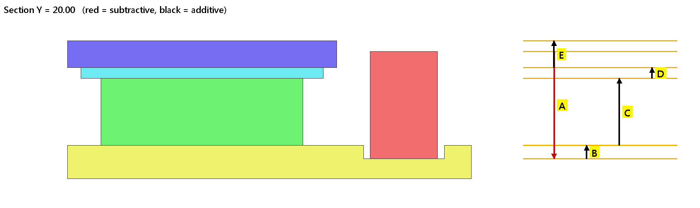

# tolstack — tolerance stack-up from 3D + 2D, straight to Excel

Pick a **gap** or **step** between two faces of a STEP assembly. tolstack finds the chain of parts
in between, reads the tolerances from your 2D drawings (or the general-tolerance table), and gives
you worst case, RSS and Monte Carlo results in an Excel file with live formulas, a colour section
picture and screenshots of the 2D evidence.



## What it does

1. **Reads the STEP assembly**: every part, its name and its planar faces along the stack-up axis (X/Y/Z).
2. **Finds contacts**: two parts touch when a top face of one sits on a bottom face of the other at
   the same height, with overlapping outlines.
3. **Builds the chain** from your *From* face to your *To* face through the touching parts (shortest
   path). Each part contributes the distance between the two faces it uses. The sum is checked
   against the 3D: `Result = To − From`.
4. **Finds tolerances**:
   - The 2D PDF whose file name matches the part name is searched for that dimension
     (`62.73±0.1`, `2 +0/-0.05`, …). The hit is cropped with a red box as evidence.
   - Otherwise the **general tolerance table** applies (editable; default 0–10 ±0.05, 10–50 ±0.10, >50 ±0.15).
5. **Analyzes**: nominal, mean shift for asymmetric tolerances, worst case, RSS (3σ),
   contribution %, and a Monte Carlo % out of spec.
6. **Writes Excel**: a stack-up table with formulas (edit a tolerance and everything recalculates),
   a PASS/FAIL verdict, a contribution chart, the section picture and a "2D references" sheet.

You stay in control: the chain is shown as an editable table, so you can change values, flip a
direction, or add rows the CAD cannot see, such as PCB bow, switch travel, assembly float or glue thickness.

## Install

```bash
git clone https://github.com/juw12/tolstack.git
cd tolstack
pip install -r requirements.txt        # cadquery-ocp, pymupdf, openpyxl, streamlit, shapely, ...
```

Python 3.10–3.13. Works on Windows, macOS and Linux.

## Use it

### Web app (upload files or point to a folder)

```bash
streamlit run app.py
```

1. Sidebar: upload the STEP and the 2D PDFs, **or** type the path to the STEP and to the folder with the drawings.
2. Choose **Step** or **Gap**, then the *From* part + face and the *To* part + face.
3. Optional: exclude parts the chain must not pass through (e.g. a housing that touches everything) and set LSL/USL.
4. **Build chain from 3D**, check and edit the table, then **Create Excel**.

### Command line / batch

```bash
python examples/make_demo.py                # creates a demo STEP + demo 2D PDFs
python -m tolstack faces examples/demo/demo_assembly.step --axis z     # list parts and faces
python -m tolstack run examples/demo_config.yaml                       # -> examples/out/demo_ta.xlsx
```

`demo_config.yaml` shows every option: faces, excluded parts, spec, drawing folder, general table,
extra contributors and per-item overrides.

## Limits (read before trusting a result)

- **1-D stack-ups only**, along one axis. No angles, no GD&T position or flatness, no 3D variation.
- The chain uses **planar face contacts**. Screws, snaps, springs and switch actuation points are not
  contacts in the CAD; add them as extra rows.
- 2D lookup needs PDFs with a **text layer**. Many CAD exports turn text into lines; those fall back to
  the general table. Check the "source" column and the 2D evidence sheet.
- A dimension that is not on the 2D is taken from the 3D with the general tolerance. That is a common
  practice, but it is still an assumption, and the report says so in the source column.
- Results are an engineering estimate. They do not replace a formal tolerance analysis or measured data (FAI/CPK).

## Development

```bash
pip install -r requirements.txt pytest
pytest -q
```

MIT licence.
