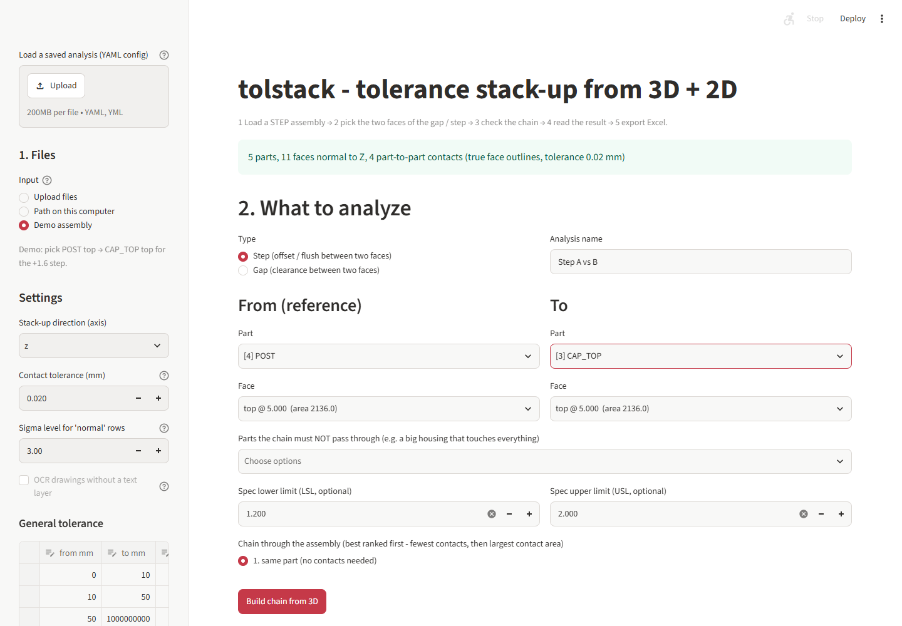
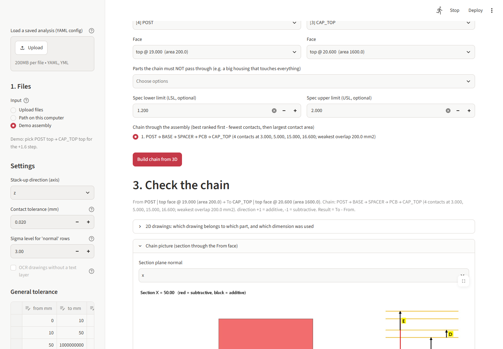
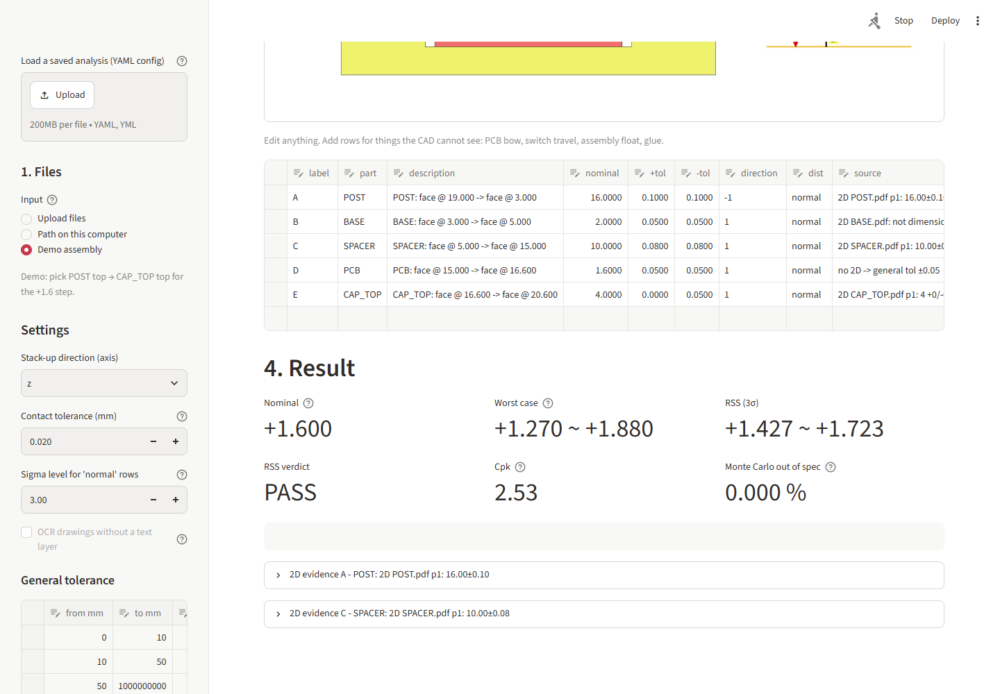

# tolstack — tolerance stack-up from 3D + 2D, straight to Excel

Pick a **gap** or **step** between two faces of a STEP assembly. tolstack finds the chain of parts
in between, reads the tolerances from your 2D drawings (or the general-tolerance table), and gives
you worst case, RSS, Cp/Cpk and Monte Carlo results in an Excel file with live formulas, a colour
section picture, the 2D evidence and a reviewer sign-off block.

| pick the faces and the chain | check the chain (with section picture) | result |
|---|---|---|
|  |  |  |

Try it in one command: `python -m tolstack demo tolstack_demo --run` (writes a demo STEP, 2D PDFs, a config and the Excel report).

## What it does

1. **Reads the STEP assembly**: every part, its name and its planar faces along the stack-up axis (X/Y/Z).
2. **Finds contacts**: a top face of one part and a bottom face of another at the same height (within
   the *contact tolerance*, default 0.02 mm) whose **real face outlines** overlap — holes and L-shapes
   included, so two parts whose bounding boxes overlap but whose material does not touch are not linked.
3. **Lists the possible chains** from your *From* face to your *To* face, ranked: fewest contacts first,
   then the largest weakest contact area. You see every candidate and pick the one that matches how the
   parts are really held. Each part contributes the distance between the two faces it uses. The chain is
   always checked against the 3D (`sum of rows = To − From`); a chain that does not close is refused.
4. **Finds tolerances**:
   - The 2D PDF whose file name matches the part name (or the one you assign) is searched for that
     dimension: `62.73±0.1`, `2 +0/-0.05`, limit dimensions `12.10/12.00` or `5.95~6.05`.
     All candidates are ranked and shown; you can pick another one. The used one is cropped with a red box as evidence.
   - Title-block notes ("TOLERANCES UNLESS SPECIFIED …") are ignored so they cannot be mistaken for a dimension.
   - If the 3D nominal differs from the drawing nominal, the **drawing limits are kept** and the difference is noted.
   - Drawings without a text layer (text exported as lines) are flagged; with Tesseract installed they can be OCR'd.
   - Otherwise the **general tolerance table** applies (editable; default 0–10 ±0.05, 10–50 ±0.10, >50 ±0.15).
5. **Analyzes**: nominal, mean shift for asymmetric tolerances, worst case, RSS, Cp, Cpk, predicted ppm and yield,
   contribution %, and a Monte Carlo % out of spec. Each row can be `normal` (±3σ by default), `uniform`
   or `triangular`.
6. **Writes Excel**: inputs in yellow, everything else a formula (edit a tolerance or a distribution and the
   whole stack, Cp/Cpk and verdicts recalculate), PASS/FAIL, contribution chart, section picture,
   "2D references" sheet, "Assumptions" sheet (method, chain used, other chains found, general table) and a
   Prepared / Checked / Approved block. Prints landscape on one page width.

You stay in control: the chain is an editable table, so you can change values, flip a direction, or add
rows the CAD cannot see, such as PCB bow, switch travel, assembly float or glue thickness.

## Install

```bash
git clone https://github.com/juw12/tolstack.git
cd tolstack
pip install -e ".[app]"          # or: pip install -r requirements.txt
```

Python 3.10–3.13. Works on Windows, macOS and Linux. Optional: [Tesseract](https://github.com/tesseract-ocr/tesseract)
for OCR of drawings without a text layer.

## Use it

### Web app

```bash
streamlit run app.py
```

1. Sidebar: **Demo assembly** (to try it), upload the STEP and 2D PDFs, **or** type the path to the STEP and the drawing folder.
   A saved YAML config can be loaded at the top of the sidebar to restore an analysis.
2. Choose **Step** or **Gap**, then the *From* part + face and the *To* part + face; set LSL/USL (optional).
3. Pick the chain from the ranked list (and exclude parts that must not be in it), then **Build chain from 3D**.
   A section picture of the chain appears right away.
4. Check the table. Open "2D drawings" to assign a drawing to a part or choose another dimension candidate.
5. Read the result (nominal, WC, RSS, verdict, Cpk, Monte Carlo), then **Create Excel**.
   **Download this analysis as a config** saves a YAML you can re-run from the command line.

### Command line / batch

```bash
python -m tolstack demo examples/demo --run                            # demo STEP + 2D PDFs + config -> Excel
python -m tolstack faces examples/demo/demo_assembly.step --axis z     # parts, faces, contact count
python -m tolstack paths examples/demo_config.yaml                     # candidate chains
python -m tolstack run examples/demo_config.yaml                       # -> examples/out/demo_ta.xlsx
```

After `pip install -e .` the same commands work as `tolstack demo|faces|paths|run`.

### Config file (version 1)

| key | meaning |
|---|---|
| `version` | config schema version, `1` |
| `step`, `axis` | STEP file (relative to the config) and stack-up axis `x`/`y`/`z` |
| `from`, `to` | `{part, face: top/bottom, level}`; result = to − from |
| `exclude` | parts the chain must not pass through |
| `chain_option` | which ranked chain to use (1 = best), see `tolstack paths` |
| `contact_tol` | faces closer than this (mm) count as touching |
| `spec` | `{lsl, usl}` |
| `drawings`, `drawing_map`, `ocr` | PDF globs; `{PART: file.pdf}` overrides (`''` = no drawing); OCR on/off |
| `general_tolerance` | `[[from, to, ±tol], ...]` |
| `sigma_level`, `mc_samples` | tolerance = ±k σ for `normal` rows; Monte Carlo sample count |
| `extra` | rows that are not part thickness (bow, travel, float …) |
| `overrides` | per row label, e.g. `{B: {tol_plus: 0.03, tol_minus: 0.03, dist: uniform, source: "CPK data"}}` |
| `section`, `output`, `title`, `project`, `name`, `type`, `author` | report options |

Unknown keys are rejected, so a typo cannot silently change a result. See `examples/demo_config.yaml`.

## Limits (read before trusting a result)

- **1-D stack-ups only**, along one axis. No angles, no GD&T position or flatness, no 3D variation.
- Contacts are **planar faces normal to the axis**. Screws, snaps, springs, cylindrical seats and switch
  actuation points are not contacts in the CAD; add them as extra rows.
- 2D lookup needs PDFs with a **text layer** (or Tesseract for OCR). Check the source column and the 2D evidence sheet.
- A dimension that is not on the 2D is taken from the 3D with the general tolerance. That is common
  practice, but it is still an assumption, and the report says so in the source column.
- Cp/Cpk and ppm assume the sum is normally distributed; Monte Carlo uses the per-row distributions.
- Results are an engineering estimate. They do not replace a formal tolerance analysis or measured data (FAI/CPK).

## Development

```bash
pip install -e ".[app,dev]"
pytest -q
```

See `CONTRIBUTING.md` for the code layout and the rules for changes, and `CHANGELOG.md` for what changed.

MIT licence.
